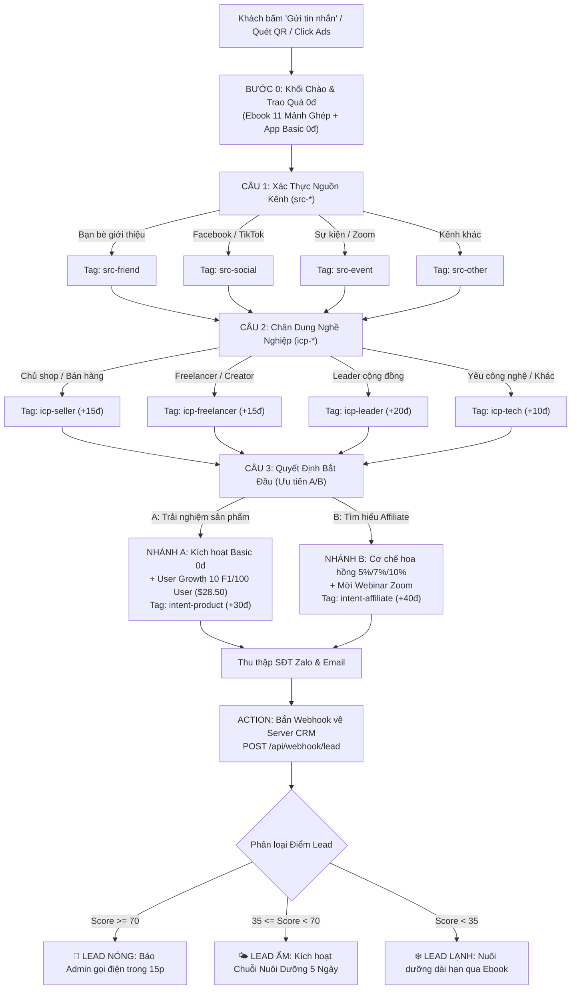

# KỊCH BẢN THIẾT KẾ CHATBOT OHANA-C (MANYCHAT / BOTCAKE / ZALO OA)
**Căn cứ: Tài liệu Kịch bản Chatbot 3 Câu Hỏi Sàng Lọc (Bản chuẩn tháng 10/2026)**
**Thời lượng tương tác: Dưới 90 giây · Tỷ lệ chuyển đổi tối ưu · Tuân thủ 100% chính sách**

---

## 1. SƠ ĐỒ CẤU TRÚC LUỒNG SÀNG LỌC 90 GIÂY



---

## 2. NỘI DUNG TỪNG KHỐI TIN NHẮN (COPY-PASTE VÀO BOTCAKE / MANYCHAT)

### 🟢 BƯỚC 0: CHÀO VÀ TRAO QUÀ 0Đ (M01 & M02)
* **Quy tắc:** Trao quà trước, hỏi sau. Không bán hàng ở khối này.
* **Tên khối:** `M01_CHAO_TRAO_QUA`
* **Nội dung tin nhắn:**
```text
Chào anh/chị {{first_name}}, em là trợ lý của cộng đồng OHANA-C (One Universe | One Family) 👋

Em gửi anh/chị bộ khởi đầu 0đ trước nhé:
1️⃣ Tài liệu Ebook "11 Mảnh Ghép Ohana" (Bản gốc 14 trang)
2️⃣ Tài khoản Ohana Basic miễn phí trải nghiệm không giới hạn
3️⃣ Bộ 5 video hướng dẫn đăng ký và kích hoạt từng bước

Anh/chị bấm nút bên dưới để mở xem thử nhé. Em xin phép hỏi nhanh 3 câu (chưa tới 1 phút) để gợi ý đúng phần công cụ phù hợp nhất với công việc của anh/chị ạ!
```
* **Nút bấm đính kèm (Buttons):**
  * Nút 1 (Link): `📄 Tải Ebook 11 Mảnh Ghép` -> `http://localhost:3002/ohana-11-manh-ghep.pdf`
  * Nút 2 (Link): `📲 Tạo Tài Khoản Basic 0đ` -> `https://ohana.astronixa.com/register`
  * Nút 3 (Chuyển khối): `🚀 Trả lời 3 câu hỏi nhanh` -> Chuyển đến `M03_CAU_1`

* **Smart Delay dự phòng (M02):**
  * Sau 10 phút nếu chưa bấm trả lời 3 câu:
  > *"Anh/chị {{first_name}} ơi, bộ khởi đầu 0đ em gửi ở trên vẫn đang chờ anh/chị mở. Anh/chị bấm vào 'Trả lời 3 câu hỏi nhanh' để em hướng dẫn đúng nhu cầu nhé!"*

---

### 🟡 CÂU 1: XÁC THỰC NGUỒN KÊNH (M03)
* **Tên khối:** `M03_CAU_1`
* **Nội dung tin nhắn:**
```text
Câu 1/3: Anh/chị biết tới cộng đồng Ohana qua đâu ạ?
```
* **Quick Replies (Trả lời nhanh):**
  1. `👥 Bạn bè giới thiệu` -> Gắn Tag: `src-friend` -> Chuyển đến `M04_CAU_2`
  2. `📱 Facebook / TikTok` -> Gắn Tag: `src-social` -> Chuyển đến `M04_CAU_2`
  3. `🎤 Sự kiện / Zoom` -> Gắn Tag: `src-event` -> Chuyển đến `M04_CAU_2`
  4. `🌐 Kênh khác` -> Gắn Tag: `src-other` -> Chuyển đến `M04_CAU_2`

---

### 🟡 CÂU 2: CHÂN DUNG NGHỀ NGHIỆP (M04)
* **Tên khối:** `M04_CAU_2`
* **Nội dung tin nhắn:**
```text
Câu 2/3: Công việc hiện tại của anh/chị gần nhất với nhóm nào ạ?
(Em hỏi để gợi ý đúng tính năng thực tế, không hỏi để bán gói đâu ạ)
```
* **Quick Replies:**
  1. `🛍️ Bán hàng online / chủ shop` -> Gắn Tag: `icp-seller`, Set Field `lead_score` = `lead_score + 15` -> Sang `M06_CAU_3`
  2. `🎨 Freelancer / creator` -> Gắn Tag: `icp-freelancer`, Set Field `lead_score` = `lead_score + 15` -> Sang `M06_CAU_3`
  3. `👑 Leader cộng đồng / đào tạo` -> Gắn Tag: `icp-leader`, Set Field `lead_score` = `lead_score + 20` -> Sang `M06_CAU_3`
  4. `💻 Yêu công nghệ / khác` -> Gắn Tag: `icp-tech`, Set Field `lead_score` = `lead_score + 10` -> Sang `M06_CAU_3`

---

### 🔴 CÂU 3: CÂU QUYẾT ĐỊNH (M06)
* **Tên khối:** `M06_CAU_3`
* **Nội dung tin nhắn:**
```text
Câu 3/3: Anh/chị muốn bắt đầu theo hướng nào ạ?
```
* **Quick Replies:**
  1. `🅰️ Trải nghiệm sản phẩm trước` -> Gắn Tag: `intent-product`, Set Field `lead_score` = `lead_score + 30` -> Chuyển sang `M07_NHANH_A`
  2. `🅱️ Tìm hiểu thêm cơ hội Affiliate` -> Gắn Tag: `intent-affiliate`, Set Field `lead_score` = `lead_score + 40` -> Chuyển sang `M09_NHANH_B`

---

### 🟢 PHÂN NHÁNH A: TRẢI NGHIỆM SẢN PHẨM (M07 & M08)
* **Tên khối:** `M07_NHANH_A`
* **Nội dung tin nhắn:**
```text
Tuyệt vời ạ! Anh/chị tạo tài khoản Basic miễn phí tại link bên dưới — có ngay Ref Link của riêng mình dù chưa mua gói nào:
👉 https://ohana.astronixa.com/register

🎁 Đặc quyền 0đ từ chương trình User Growth:
Nếu anh/chị chia sẻ app tới 10 người trực tiếp (F1) và có 100 người trong mạng lưới tải app Ohana, hệ thống sẽ tự động tặng gói Ohana Social 6 tháng (trị giá $28.50) hoàn toàn miễn phí!

Sau 3 ngày dùng thử, em sẽ hỏi lại cảm nhận và chỉ khi anh/chị chủ động hỏi, em mới giới thiệu các gói trả phí theo bảng giá chính thức ạ.
```
* **Nút bấm:**
  * `📱 Tải App & Đăng Ký 0đ` -> `https://ohana.astronixa.com/register`
  * `🎥 Xem 5 Video Onboarding` -> Chuyển sang `BLOCK_VIDEO_ONBOARDING`
  * `💬 Để lại SĐT nhận hỗ trợ Zalo` -> Chuyển sang `FORM_THU_PHONE`

---

### 🟢 PHÂN NHÁNH B: CƠ HỘI AFFILIATE (M09 & M10)
* **Tên khối:** `M09_NHANH_B`
* **Nội dung tin nhắn:**
```text
Dạ rất hoan nghênh anh/chị! Cơ chế cộng đồng OHANA-C Affiliate:
• Hoa hồng trực tiếp: 5% / 7% / 10% theo từng nhóm sản phẩm qua Ref Link cá nhân.
• Hoa hồng phân hệ AI Points: 5% riêng biệt.
• Không áp lực: Không ôm hàng tồn kho, không phí duy trì vô lý.
• Tự động hóa: Được cấp sẵn hệ thống Funnel 24/7 và bộ 5 video chuyển giao 60 phút.

Tối nay có buổi Webinar Ohana Meet trực tiếp giải đáp mọi thắc mắc và định hướng thực chiến. Anh/chị bấm đăng ký giữ chỗ nhé!
```
* **Nút bấm:**
  * `🎟️ Đăng ký giữ chỗ Webinar` -> Gắn Tag: `event-registered` (+20đ), Chuyển sang `FORM_THU_PHONE`
  * `💬 Tham gia Nhóm Zalo Hỗ Trợ` -> `https://zalo.me/g/dkw23jqczybbdk0fxj`
  * `🎥 Xem 5 Video Onboarding 60 Phút` -> Chuyển sang `BLOCK_VIDEO_ONBOARDING`

---

### 📞 FORM THU THẬP SĐT ZALO (FORM_THU_PHONE)
* **Khối User Input:**
```text
Để trợ lý gửi tài liệu hướng dẫn chuyên sâu qua Zalo và nhắc lịch phòng Zoom, anh/chị nhập giúp em Số điện thoại Zalo của mình nhé (10 số, bắt đầu bằng 0):
```
* **Validation:** Regex `^0[0-9]{9}$`
* **Sau khi nhập xong:**
  * Lưu vào User Field: `phone`
  * Thêm Tag: `has-phone` (+20đ)
  * Kích hoạt **Webhook Call**:
    * **URL:** `http://localhost:3002/api/webhook/lead`
    * **Method:** `POST`
    * **Payload:**
    ```json
    {
      "name": "{{first_name}} {{last_name}}",
      "phone": "{{phone}}",
      "persona": "{{icp}}",
      "goal": "{{goal}}",
      "source": "Facebook Messenger / ManyChat",
      "utm_source": "{{utm_source}}"
    }
    ```

---

## 3. BỘ XỬ LÝ CÂU HỎI CHEN NGANG (DEFAULT REPLIES / KEYWORDS)

Cài đặt trong mục **Automation > Default Reply / Keywords** trên ManyChat hoặc Botcake:

| Từ khóa bắt được | Mẫu tin nhắn phản hồi tự động chuẩn mực |
| :--- | :--- |
| **"Đa cấp", "MLM", "lừa đảo"** | "Dạ không ạ. Đây là Affiliate Marketing (Tiếp thị liên kết) chuẩn mực — tương tự Amazon, Shopee: Hoa hồng chỉ phát sinh từ doanh số sản phẩm thật qua Ref Link; không bắt buộc ôm hàng và hoàn toàn không có thu nhập nếu chỉ tuyển người mà không có giao dịch sản phẩm thật ạ." |
| **"Sợ bị lừa", "uy tín không"** | "Dạ anh/chị đừng vội tin lời quảng cáo — hãy tự mình kiểm chứng ạ: Tạo tài khoản Basic miễn phí (0đ, 0 rủi ro), tải ứng dụng dùng thử tính năng thật và xem hồ sơ pháp lý minh bạch của công ty trước khi đưa ra quyết định nhé!" |
| **"Cam kết thu nhập", "lãi bao nhiêu"** | "Cộng đồng OHANA-C và Astronixa tuyệt đối KHÔNG cam kết bất kỳ mức thu nhập hay lợi nhuận cố định nào ạ. Mọi khoản thu nhập đều đến từ năng lực và nỗ lực tiếp thị thực tế theo đúng tôn chỉ: Nói đúng – Nói đủ – Không thổi phồng." |
| **"Co-Founder", "VIP", "cổ phần"** | "Chương trình Co-Founder Membership là chương trình giới hạn dành cho đối tác chiến lược cấp cao (mức $5,000 - $50,000). Chương trình này không tư vấn qua bot. Em xin phép chuyển thông tin để Trưởng ban phát triển trao đổi riêng 1-1 với anh/chị nhé!" *(Gắn Tag: `intent-cofounder`, Báo Admin)* |
| **"Pháp lý công ty"** | "Ohana do Astronixa LLC phát triển — công ty đăng ký tại bang Delaware, Hoa Kỳ. Tại Việt Nam, Công ty TNHH Astronixa (Tầng 7 Rise Building, 2A1 Nguyễn Thị Minh Khai, Q.1, TP.HCM) phụ trách tiếp thị và chăm sóc người dùng theo Hợp đồng ký ngày 01/06/2026 ạ." |
